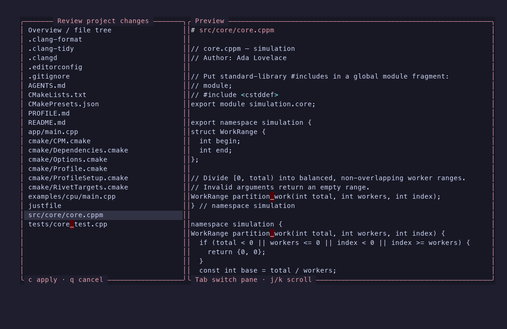

# Rivet.nvim

Create C++, C, Python, Rust, SwiftPM, and Lua projects from Neovim or the shell,
add files and targets from templates, and run each project's native build
tools. Every change is previewed as a complete file plan before anything is
written.



- **Modern C++ without guesswork.** C++17 through C++26 with CMake presets,
  Ninja, and CPM. Named modules, `import std;`, headers, and layout are
  separate, explicit choices.
- **Document the API alongside the code.** Doxygen headers and a
  [Doxygen HTML/XML guide](docs/src/content/doxygen.svx) help connect C/C++
  projects to documentation tools.
- **Native tools, not a new build system.** Generated projects are ordinary
  CMake, `pyproject.toml`, Cargo, or SwiftPM projects. Existing projects work
  without conversion.
- **Reviewed changes only.** Rivet refuses to overwrite your files, and refuses
  a plan if the files changed after you previewed it.
- **One model, two front ends.** The Neovim plugin and the optional `rivet` CLI
  share the same project model and templates.

## Requirements

- Neovim 0.11+ for the plugin; Lua 5.1+ or LuaJIT for the optional CLI.
  No LuaRocks packages are needed.
- The tools for the languages you use. C++ needs CMake 3.30+ and, for
  modules, Ninja 1.11+ with a compiler that supports dependency scanning
  (Homebrew LLVM on macOS works well). Rivet never installs compilers or
  packages.
- macOS or Linux.

See [Compatibility](docs/src/content/compatibility.svx) for tested toolchains
and the narrower requirements of `import std;`.

## Install

With Neovim 0.12+'s built-in package manager:

```lua
vim.pack.add({
  {
    src = 'https://github.com/guzman109/Rivet',
    name = 'rivet.nvim',
    version = vim.version.range('0.1.x'),
  },
})
require('rivet').setup()
```

With [lazy.nvim](https://github.com/folke/lazy.nvim):

```lua
{
  'guzman109/Rivet',
  name = 'rivet.nvim',
  main = 'rivet',
  version = '0.1.x',
  opts = { default_preset = 'debug' },
}
```

Your package manager downloads Rivet; no manual clone or compilation is needed.
To update with `vim.pack`, run
`:lua vim.pack.update({ 'rivet.nvim' })`, review and save the update, and restart
Neovim. lazy.nvim users can use `:Lazy update rivet.nvim`. Use a fixed tag to
pin a release or `main` to follow development. After updating Rivet, review
`:RivetUpgrade` in each project to update its supplementary files separately.
See [CHANGELOG.md](CHANGELOG.md) for release changes.

Or add a checkout to your runtime path:

```lua
vim.opt.runtimepath:prepend(vim.fn.expand('/path/to/rivet.nvim'))
require('rivet').setup({ default_preset = 'debug' })
```

## Use it

In Neovim, run `:Rivet new`, answer the questions while comparing previews,
and press `c` on the final review to create the project. Then:

```vim
:Rivet file          " choose language, source/header pair, module pair, or Lua script
:Rivet task build    " configure and build; errors go to quickfix
:Rivet task run      " build and run the application
:Rivet config        " edit tool settings with explanations and a reviewed diff
:Rivet upgrade       " review updated supplementary templates
:Rivet output        " reopen task output
:Rivet stop          " stop the current project task
:Rivet doctor        " check the toolchain this project actually uses
```

Every subcommand also exists as a `:Rivet…` command (`:RivetNew`,
`:RivetTask build`, …). `:help rivet` lists them all with their keys.

Task output shows its controls: `q` closes the view, Enter closes completed output, and Ctrl-C stops a running task. Set `task_output = 'close-on-success'` in `setup()` to close successful output automatically; reopen it with `:Rivet output`.

From the shell, add `bin/` to your `PATH`:

```sh
rivet new ./engine --name engine --modules true --preview  # review the plan
rivet new ./engine --name engine --modules true             # create it
rivet build --root ./engine --preset debug
rivet test --root ./engine --preset debug
```

## Documentation

The guides live in [`docs/src/content`](docs/src/content) and build into the
documentation site ([development guide](docs/README.md)):

- [Start here](docs/src/content/start-here.svx) and
  [your first C++ project](docs/src/content/first-project.svx)
- [Neovim plugin](docs/src/content/neovim.svx),
  [CLI](docs/src/content/cli.svx), and
  [configuration](docs/src/content/configuration.svx)
- [Modules](docs/src/content/modules.svx),
  [CMake and tasks](docs/src/content/cmake.svx),
  [styles and layouts](docs/src/content/styles-layouts.svx), and
  [files and targets](docs/src/content/templates.svx)
- [Your first project in each language](docs/src/content/start-here.svx),
  [Doxygen API documentation](docs/src/content/doxygen.svx)
- Languages: [C](docs/src/content/c.svx), [Python](docs/src/content/python.svx),
  [Rust](docs/src/content/rust.svx), [SwiftPM](docs/src/content/swift.svx),
  [Lua and Neovim plugins](docs/src/content/lua.svx);
  workloads: [HPC](docs/src/content/hpc.svx),
  [graphics](docs/src/content/graphics.svx)
- [Project upgrades](docs/src/content/upgrading.svx), [Existing projects](docs/src/content/existing-projects.svx),
  [troubleshooting](docs/src/content/troubleshooting.svx), and
  [writing a language provider](docs/src/content/extending.svx)

## Development

```sh
lua tests/run.lua && luajit tests/run.lua
lua tests/licenses.lua && lua tests/migration.lua
for t in tests/lua_provider.lua tests/native_regressions.lua tests/file_templates.lua tests/tool_config.lua tests/upgrades.lua tests/embedding.lua tests/cli_features.lua; do lua "$t"; done
lua tests/integration.lua      # builds real projects with installed toolchains
for t in tests/nvim*.lua; do nvim --headless -u NONE -i NONE -l "$t"; done
stylua --check lua tests bin plugin
VIMRUNTIME=$(nvim --clean --headless +'lua io.write(vim.env.VIMRUNTIME)' +q) \
  lua-language-server --check . --checklevel=Warning
```

`tests/batches.lua` runs the native-language and optional GPU checks; it reports
skipped checks separately from passes. [RELEASING.md](RELEASING.md) lists the
release gates.

## Formerly Outset

Rivet was previously named Outset. `require('outset')` and `bin/outset` still
work, with a deprecation warning, until 0.3.0. Run `:RivetMigrate` (or
`rivet migrate --preview`) in an Outset project to review its conversion.

## License

MIT, copyright 2026 Carlos Guzman; see [LICENSE](LICENSE). License templates
offered to generated projects keep their upstream terms; see
[LICENSE-TEMPLATES.md](LICENSE-TEMPLATES.md).
